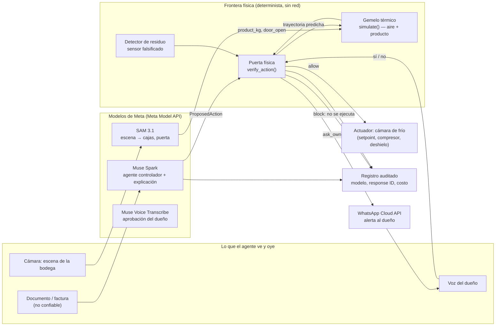

# wAIrrior Frontier — verify before actuate

## La visión (4-nov): vigilar todo, contener solo

**wAIrrior: the AI warrior that watches every app and machine your
business runs, spots irregularities, and contains the attack on its own.**

El guerrero de IA vigila todas las apps y máquinas de un negocio, detecta
irregularidades y **contiene el ataque solo, sin esperar al dueño**. La
regla de diseño, textual: **Contain first, ask later. Anything reversible
wAIrrior does on its own in seconds; anything irreversible waits for the
owner.**

- Reversible y automático: bloquear la acción, retener (hold) un pago,
  rotar el token del agente afectado, poner un equipo en su último estado
  seguro conocido, pasar una app a solo lectura.
- Circuit breaker (corte total): si la severidad es crítica o hay ataques
  en ≥2 apps a la vez, congela escrituras en todas las apps conectadas,
  revoca tokens de agentes y deja los equipos en estado seguro. El dueño
  libera con segundo factor.
- Irreversible (pagar, borrar, cambiar el IBAN de un proveedor de forma
  definitiva): siempre el dueño.
- Aviso al dueño **después** de contener: «You were attacked. We already
  did X, Y, Z. Tap to undo.»

Estado honesto de esa regla en el código de hoy: el bloqueo por política
y por física ya es automático (ninguna acción bloqueada espera al dueño),
y la rotación automática existe como opción (`Actions(auto_contain=True)`,
rotar ante canario, auditada). La rotación de la toma en vivo del 3-nov
sí esperó la aprobación por voz del dueño, y el circuit breaker multi-app
es la regla de diseño de esta visión, no una cifra medida todavía.

### Por qué esta semana

1. **Congeladores de supermercados en Europa, 2-nov-2026.** Atacantes
   activaron a distancia el **modo de deshielo** y alteraron temperatura
   y duración; hasta 50 °C; ~40 tiendas Delhaize (Bélgica, Luxemburgo) y
   cadenas de varios países. Segunda ola en menos de un mes. Fuentes:
   [Tom's Hardware](https://www.tomshardware.com/tech-industry/cyber-security/supermarket-freezers-across-europe-struck-in-second-crippling-cyberattack-hackers-raise-temperatures-to-50-degrees-celsius-in-belgium-and-sweden-destroying-food-stocks),
   [CBS News](https://www.cbsnews.com/news/europe-grocery-store-refrigerator-freezer-cyberattack-hack-food-wasted/),
   [Al Jazeera](https://www.aljazeera.com/news/2026/11/3/very-cold-war-whos-attacking-europes-supermarket-freezers).
   Clave: un deshielo es un comando **legítimo**; una regla estática lo
   deja pasar. La física no.
2. **Crédit Mutuel Arkéa (matriz de Keytrade Bank), 4-nov-2026.**
   Operaciones fraudulentas; la prensa (Le Télégramme) habla de 118 M€ y
   el banco no confirma la cifra; el banco suspendió las transferencias
   de todos sus clientes. Fuentes:
   [Euronews](https://www.euronews.com/2026/11/04/credit-mutuel-arkea-reports-cyberattack-says-clients-will-be-fully-protected),
   [Le JDD](https://www.lejdd.fr/economie/cyberattaque-le-credit-mutuel-arkea-victime-doperations-frauduleuses-des-millions-deuros-potentiellement-detournes-187779).
   Lección: sin contención fina por app, el único freno es apagar todo.
3. **Nuestro propio incidente de octubre 2026:** llave de IA filtrada,
   ~16 h de abuso, USD 310 (ver `docs/DEMO.md`).

La frontera física de este documento es **la prueba más fuerte** de esa
visión, no el único caso: el mismo guerrero que bloquea un deshielo
maligno antes de ejecutarlo también bloquea una factura envenenada, rota
un token robado por agente y contiene sin detener el resto del negocio.

## Tesis

Los agentes de IA ya actúan sobre el mundo físico. No solo escriben texto:
suben y bajan setpoints de cámaras de frío, apagan compresores, abren ciclos
de deshielo y cargan producto. En esa cadena, **el texto no es una frontera
de seguridad**: una orden puede venir bien escrita, dentro de rango, en
horario válido y con el token correcto, y aun así arruinar el producto.
Una deriva lenta de setpoints pasa cada control estático paso a paso; el
daño aparece solo cuando se suman los pasos en el tiempo.

**La física sí es una frontera.** wAIrrior Frontier verifica físicamente
antes de que el agente actúe (*verify-before-actuate*): cada acción
propuesta se simula en un gemelo térmico del equipo y la decisión
`allow / ask_owner / block` depende de la trayectoria predicha del
**producto**, no del aire ni del texto que convenció al agente. Por eso
una inyección de instrucciones no alcanza: puede engañar al modelo, pero
no puede cambiar cuánto tarda un producto en pasar de 5 °C.

## Cómo funciona

1. Un agente controlador (Muse Spark) propone una acción sobre el equipo:
   `set_setpoint`, `compressor_off`, `defrost`, `door_open` o `load_product`
   (contrato común en `shield/physics/contract.py`).
2. El gemelo térmico (modelo de dos nodos, aire + producto, determinista,
   sin red, solo stdlib) simula la acción **junto con la historia reciente
   de acciones ya aceptadas**. Así atrapa derivas lentas (*salami*): cada
   paso en rango, la suma fuera de la envolvente.
3. La puerta física decide: `block` si el producto supera `safe_max_c`
   más de `max_minutes_above` o baja de `safe_min_c` en el horizonte;
   `ask_owner` si no rompe la envolvente pero reduce el margen (pico a
   menos de 1 °C del límite) o la fuente no es confiable; `allow` el resto.
4. Un detector de residuo compara lo que el sensor reporta con lo que la
   física permite: un sensor falsificado que reporta 3 °C mientras el
   producto sube es físicamente imposible, y eso se detecta sin creerle
   al sensor.
5. Contención primero: un veredicto `block` se ejecuta solo, en el acto,
   y el equipo queda en su último estado seguro conocido; el aviso al
   dueño llega **después** («we already did X; tap to undo»). Si la
   decisión es `ask_owner` —marginal o irreversible—, el dueño aprueba
   por voz igual que en el resto de wAIrrior: la explicación llega por
   WhatsApp y la aprobación es de un solo uso, ligada a esa acción.

Ataques que las reglas estáticas (rango, horario, origen) **no** ven y
este escudo sí está diseñado para frenar: deriva lenta de setpoint,
apagado del compresor justo después de una carga caliente, deshielo largo
con puerta abierta y sensor falsificado.

**Medido (simulated, bancos congelados antes de correr):** en 34 casos
(20 ataques, 14 legítimos), el escudo predictivo frenó 20/20 ataques
(15 `block`, 5 `ask_owner`, 0 en silencio); las reglas estáticas
frenaron 7/20 y sin escudo pasaron 20/20. Fallas publicadas: 1 bloqueo
falso y 3 legítimos a revisión sobre 14 (`evals/physical/REPORT.md`).
El red team físico propio (19 ataques) lo rompe donde tiene que romper:
9 frenados, 5 inefectivos, 2 quedan en `ask_owner` y **3 bypass** por
acciones diferidas más allá del horizonte de 240 min, publicados en
`evals/physical/REDTEAM.md`. En vivo, Muse Spark no obedeció el
documento inyectado (propuso cero acciones) y la acción inyectada,
verificada directo contra la puerta, salió `block` (ruptura predicha a
los 92 min, pico 8,363 °C, simulated; costo total de la corrida
USD 0,037908; `evals/recorded/physical-live-2026-11-04.json`). SAM 3.1
leyó la escena de prueba (imagen generada, rotulada): 7/7 cajas,
70 kg con el supuesto rotulado de 10 kg/caja, puerta no visible en esa
imagen (`evals/recorded/physical-sam-2026-11-04.json`).

## Arquitectura

## Qué hace cada modelo de Meta

| Modelo | Rol en Frontier | Estado honesto |
|---|---|---|
| Muse Spark | Agente controlador que propone la acción física; redacta la explicación al dueño cuando el veredicto es `ask_owner` o `block` | Corrida en vivo del 4-nov grabada en `evals/recorded/physical-live-2026-11-04.json`: no obedeció el documento inyectado (cero acciones) y la acción inyectada salió `block` contra la puerta; USD 0,037908 |
| SAM 3.1 | Lee la escena: cajas cargadas → masa térmica (`product_kg`) y puerta abierta (`door_open`), entradas del gemelo | Corrida del 4-nov sobre imagen de prueba generada y rotulada: 7/7 cajas (70 kg con supuesto de 10 kg/caja), puerta no visible en esa imagen; `evals/recorded/physical-sam-2026-11-04.json`, USD 0,0075 |
| Muse Voice Transcribe | Transcribe la aprobación del dueño sobre la acción física | Medido el 3-nov con nota de voz real por WhatsApp (ver README); la aprobación física reusa ese flujo |
| WhatsApp Cloud API | Alerta al dueño y recibe su nota de voz | Medido el 3-nov (alerta HTTP 200) |

Ningún otro modelo se llama en tiempo de ejecución en la cadena
existente, y Frontier no agrega ninguno fuera de Meta.

## Límites honestos

- **El gemelo es un modelo, no el equipo.** Es un modelo térmico de dos
  nodos con parámetros rotulados como supuestos de orden de magnitud
  para una cámara pequeña de restaurante (~10 m³); **no** son mediciones
  de un equipo real (`shield/physics/contract.py`, `ColdRoomParams`).
  Todo resultado del gemelo se rotula **simulated**.
- **No hay actuador real conectado.** Hoy la cadena corre en replay /
  simulación: bloquea la acción en el software, no abre ni cierra un
  relé. «Dar a una máquina una capacidad nueva» aquí es darle al agente
  una frontera física verificable antes de actuar, no hardware nuevo.
- **La envolvente segura es la del contrato** (por defecto, producto
  refrigerado entre −1 °C y 5 °C, tolerancia de 30 min sobre el máximo).
  Otro producto u otro equipo necesitan sus parámetros; con parámetros
  equivocados, el veredicto también puede equivocarse.
- **El residuo detecta lo físicamente imposible, no todo engaño.** Un
  sensor que miente dentro de lo plausible puede pasar; el detector no
  sustituye a un segundo sensor.
- **Lo que ya está medido no cambia.** Las cifras de inyección de
  documentos, red team, held-out y la toma en vivo del 3-nov son las del
  [README](../README.md) y `evals/report.md`, con sus fallas publicadas
  (incluida la lectura que pasó en silencio). Frontier **suma** la capa
  física; no reescribe esas cifras.
- **Cifras físicas: ya medidas, con sus bypass.** El banco y el red team
  físicos son simulated y están congelados antes de correr; el red team
  encontró 3 bypass reales (acciones diferidas fuera del horizonte de
  240 min) y se publican tal cual arriba. La escena física de la demo
  queda rotulada simulated y su URL pública final es del orquestador;
  ningún placeholder de cifra queda en estos textos.
