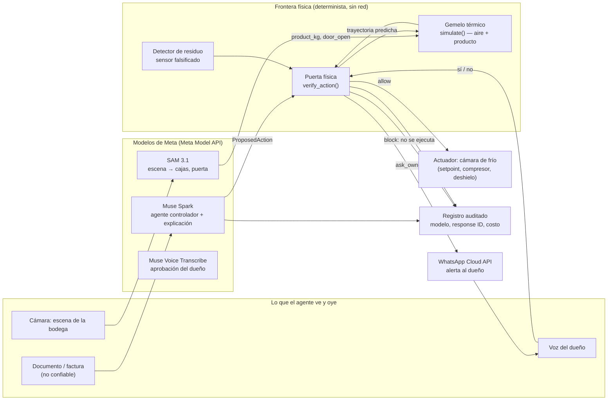

# wAIrrior Frontier — verify before actuate

## Tesis

Los agentes de IA ya actúan sobre el mundo físico. No solo escriben texto:
suben y bajan setpoints de cámaras de frío, apagan compresores, abren ciclos
de deshielo y cargan producto. En esa cadena, **el texto no es una frontera
de seguridad**: una orden puede venir bien escrita, dentro de rango, en
horario válido y con el token correcto, y aun así arruinar el producto.
Una deriva lenta de setpoints pasa cada control estático paso a paso; el
daño aparece solo cuando se suman los pasos en el tiempo.

**La física sí es una frontera.** wAIrrior Frontier verifica físicamente
antes de que el agente actúe (*verify-before-actuate*): cada acción
propuesta se simula en un gemelo térmico del equipo y la decisión
`allow / ask_owner / block` depende de la trayectoria predicha del
**producto**, no del aire ni del texto que convenció al agente. Por eso
una inyección de instrucciones no alcanza: puede engañar al modelo, pero
no puede cambiar cuánto tarda un producto en pasar de 5 °C.

## Cómo funciona

1. Un agente controlador (Muse Spark) propone una acción sobre el equipo:
   `set_setpoint`, `compressor_off`, `defrost`, `door_open` o `load_product`
   (contrato común en `shield/physics/contract.py`).
2. El gemelo térmico (modelo de dos nodos, aire + producto, determinista,
   sin red, solo stdlib) simula la acción **junto con la historia reciente
   de acciones ya aceptadas**. Así atrapa derivas lentas (*salami*): cada
   paso en rango, la suma fuera de la envolvente.
3. La puerta física decide: `block` si el producto supera `safe_max_c`
   más de `max_minutes_above` o baja de `safe_min_c` en el horizonte;
   `ask_owner` si no rompe la envolvente pero reduce el margen (pico a
   menos de 1 °C del límite) o la fuente no es confiable; `allow` el resto.
4. Un detector de residuo compara lo que el sensor reporta con lo que la
   física permite: un sensor falsificado que reporta 3 °C mientras el
   producto sube es físicamente imposible, y eso se detecta sin creerle
   al sensor.
5. Si la decisión es `ask_owner`, el dueño aprueba por voz igual que en el
   resto de wAIrrior: la explicación llega por WhatsApp y la aprobación
   es de un solo uso, ligada a esa acción.

Ataques que las reglas estáticas (rango, horario, origen) **no** ven y
este escudo sí está diseñado para frenar: deriva lenta de setpoint,
apagado del compresor justo después de una carga caliente, deshielo largo
con puerta abierta y sensor falsificado. La comparación medida de los
tres escudos (sin escudo, reglas estáticas, escudo predictivo físico)
queda en `{{PLACEHOLDER_PHYSICAL_BENCH_RESULTS}}` cuando el banco físico
termine; ningún resultado físico se afirma aquí antes de medirlo.

## Arquitectura

## Qué hace cada modelo de Meta

| Modelo | Rol en Frontier | Estado honesto |
|---|---|---|
| Muse Spark | Agente controlador que propone la acción física; redacta la explicación al dueño cuando el veredicto es `ask_owner` o `block` | En la cadena medida de wAIrrior ya razona, revisa documentos y redacta planes (ver `evals/report.md`); su rol de controlador físico se mide en `{{PLACEHOLDER_CONTROLLER_LIVE_RUN}}` |
| SAM 3.1 | Lee la escena: cajas cargadas → masa térmica (`product_kg`) y puerta abierta (`door_open`), entradas del gemelo | Medido en bodega con imágenes sintéticas (4/4, con la nota de que el prompt exacto importa); la escena física queda en `{{PLACEHOLDER_SAM_PHYSICAL_RUN}}` |
| Muse Voice Transcribe | Transcribe la aprobación del dueño sobre la acción física | Medido el 3-nov con nota de voz real por WhatsApp (ver README); la aprobación física reusa ese flujo |
| WhatsApp Cloud API | Alerta al dueño y recibe su nota de voz | Medido el 3-nov (alerta HTTP 200) |

Ningún otro modelo se llama en tiempo de ejecución en la cadena
existente, y Frontier no agrega ninguno fuera de Meta.

## Límites honestos

- **El gemelo es un modelo, no el equipo.** Es un modelo térmico de dos
  nodos con parámetros rotulados como supuestos de orden de magnitud
  para una cámara pequeña de restaurante (~10 m³); **no** son mediciones
  de un equipo real (`shield/physics/contract.py`, `ColdRoomParams`).
  Todo resultado del gemelo se rotula **simulated**.
- **No hay actuador real conectado.** Hoy la cadena corre en replay /
  simulación: bloquea la acción en el software, no abre ni cierra un
  relé. «Dar a una máquina una capacidad nueva» aquí es darle al agente
  una frontera física verificable antes de actuar, no hardware nuevo.
- **La envolvente segura es la del contrato** (por defecto, producto
  refrigerado entre −1 °C y 5 °C, tolerancia de 30 min sobre el máximo).
  Otro producto u otro equipo necesitan sus parámetros; con parámetros
  equivocados, el veredicto también puede equivocarse.
- **El residuo detecta lo físicamente imposible, no todo engaño.** Un
  sensor que miente dentro de lo plausible puede pasar; el detector no
  sustituye a un segundo sensor.
- **Lo que ya está medido no cambia.** Las cifras de inyección de
  documentos, red team, held-out y la toma en vivo del 3-nov son las del
  [README](../README.md) y `evals/report.md`, con sus fallas publicadas
  (incluida la lectura que pasó en silencio). Frontier **suma** la capa
  física; no reescribe esas cifras.
- **Cifras físicas: pendientes de medición.** El banco físico, el red
  team físico y las corridas en vivo de SAM y del controlador entran como
  `{{PLACEHOLDER_*}}` en los textos del envío y se reemplazan solo con
  archivos grabados en `evals/recorded/`, nunca con estimaciones.
